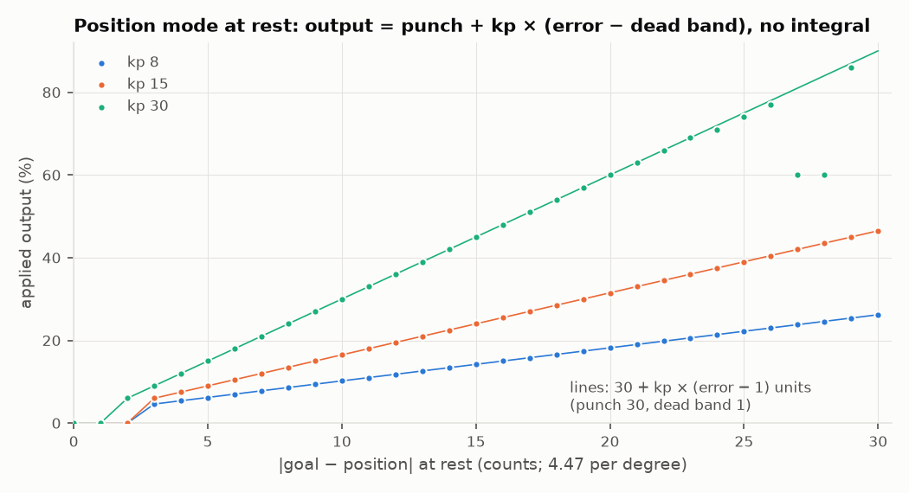
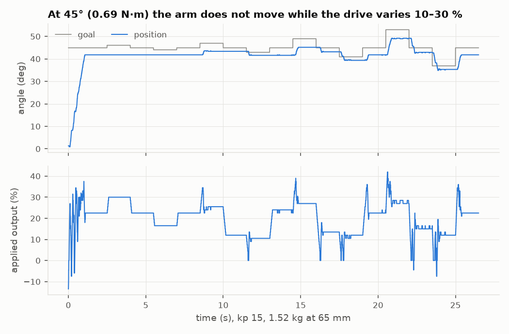
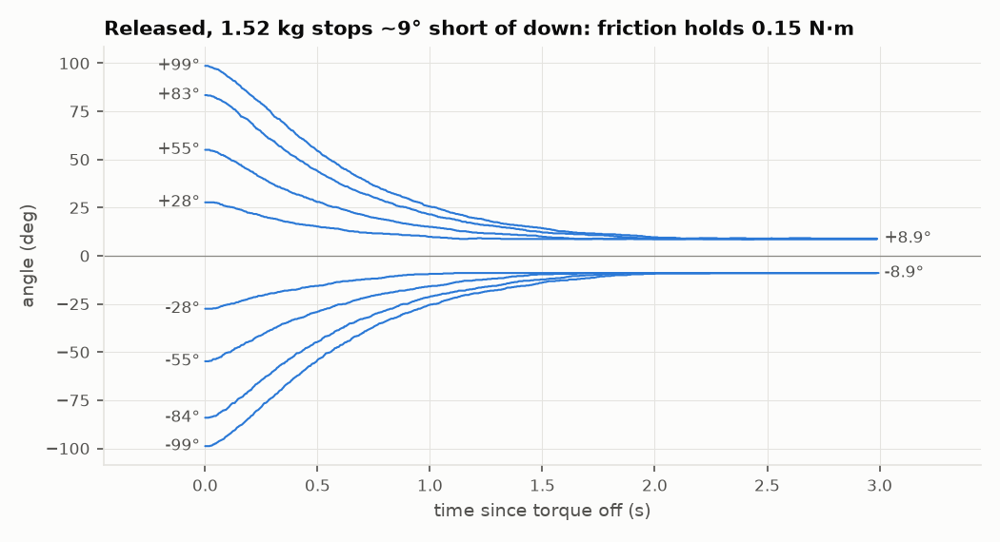
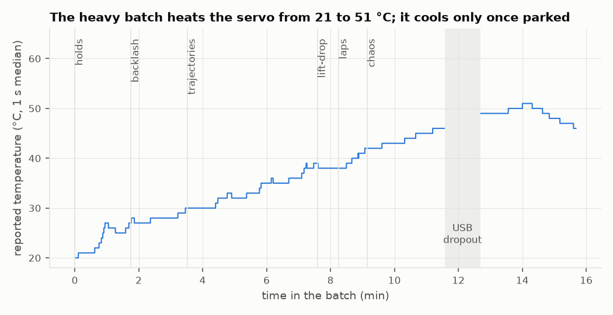
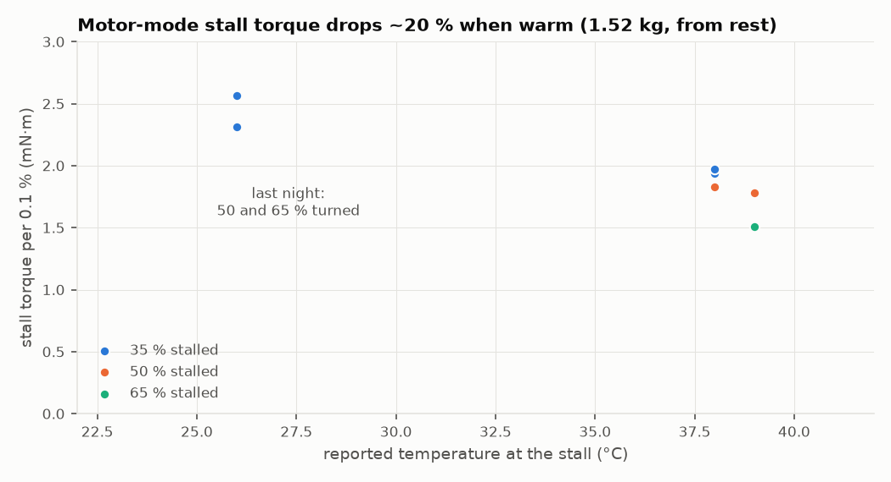
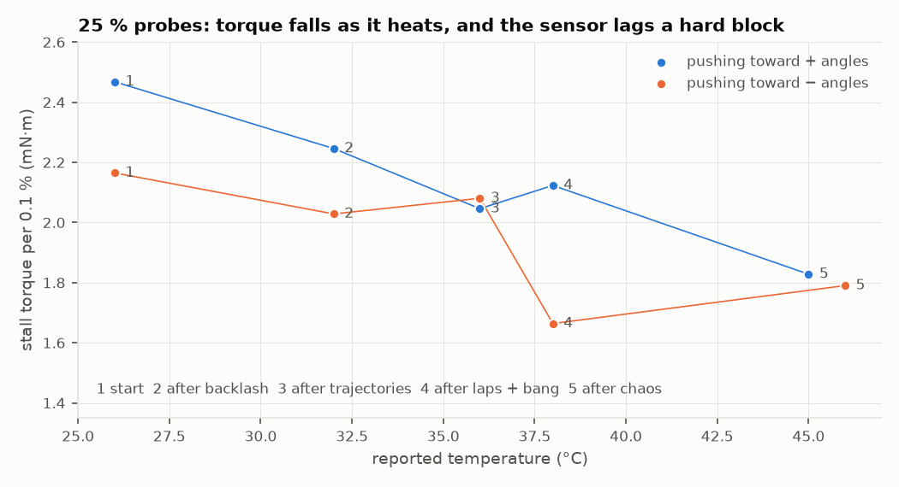
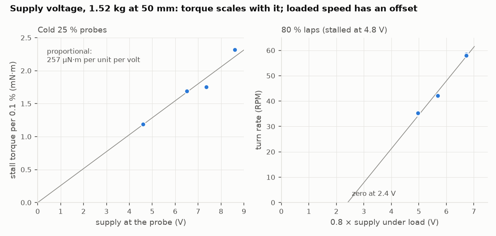
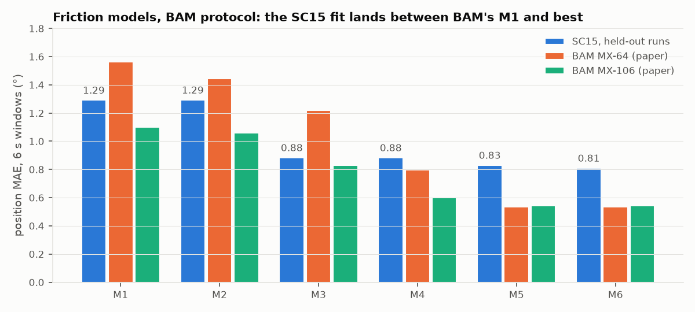
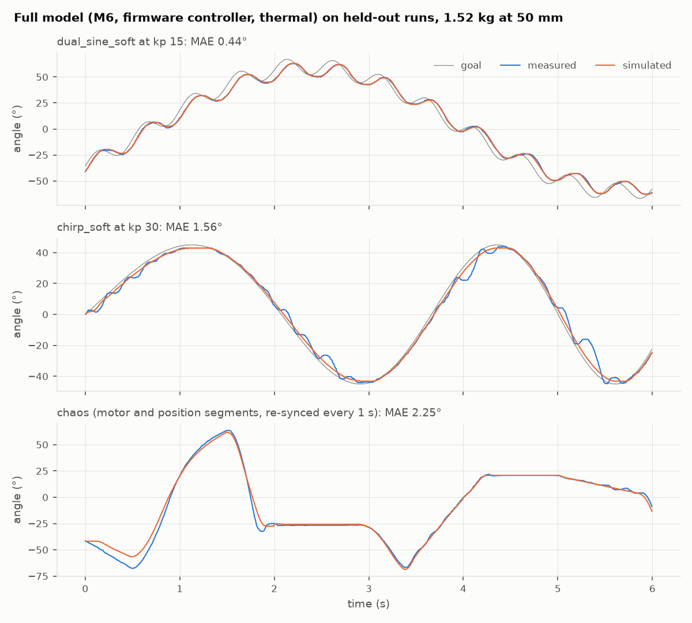

# SC15: measured characteristics

Generated by [`../render.py`](../render.py) from the raw runs in
[`../data`](../data). Rerun it after adding data. The numbers and how
they were derived are in [`../README.md`](../README.md).

Setup: one SC15 (ID 1) on the pendulum stand, supply ~8.7 V, 250 Hz
telemetry. Unit 1 was destroyed in the last (hot) runs; every chart here
uses healthy data. Angles are measured from hanging straight down (count 513).
**+PWM drives the position count down.**

## Actuator dynamics

### Motor mode: output slew

<picture>
  <source media="(prefers-color-scheme: dark)" srcset="charts/motor_slew-dark.png">
  
</picture>

The firmware ramps the applied PWM toward the command at exactly
1.25 units/ms, in both directions and at every level. That ramp is the
dominant motor-mode dynamic: a full reversal takes 1.6 s, or 0.8 s with
the position-mode "bounce", which resets the output to 0.
Source: `chaos_20261029_181040_arm-only-laps`.

### Position mode: asymmetric slew

<picture>
  <source media="(prefers-color-scheme: dark)" srcset="charts/position_slew-dark.png">
  
</picture>

When the goal flips, position mode collapses the output through zero at
~100 units/ms, then builds it in the new direction at 5 units/ms. Full
reverse PWM therefore never meets full opposing speed. The simulator
needs this asymmetric slew, not a symmetric rate limit.
Source: `chaos_20261030_013021_bang-reversals-1.52kg-at-65mm`.

### Position mode: the output law at rest

<picture>
  <source media="(prefers-color-scheme: dark)" srcset="charts/position_law-dark.png">
  
</picture>

At rest, the applied output is exactly **30 + kp × (|error| − 1)** units:
the punch register (0x18–19 = 30) plus P beyond the 1-count dead band.
There is no integral, so a held load sags until the P term carries it
(14 counts, 3.1°, at 45° with 1.52 kg and kp 15). Within ±2 counts
(±1 at kp 30) the output is 0. This is the static part of the
position-mode model; D and the slew act while moving.
Source: `chaos_20261030_093448_heavy-batch-1.52kg-at-65mm` (all settled position-mode frames).

### Position steps (unloaded)

<picture>
  <source media="(prefers-color-scheme: dark)" srcset="charts/step_response-dark.png">
  
</picture>

A flat-out step (goal time 1 ms) settles within 10 counts in ~169 ms
plus 0.46 ms per count, with no overshoot and ±1 count final error.
Source: `chaos_20261028_173504_unloaded`.

## Speed and sensing

### Speed against PWM

<picture>
  <source media="(prefers-color-scheme: dark)" srcset="charts/speed_vs_pwm-dark.png">
  
</picture>

With the arm only, speed is linear in PWM, with no dead band and the
two directions within 3 %. Full PWM gives ~75 RPM. With 1.52 kg at
65 mm, the mean turn rate drops at low PWM because each turn crawls
past horizontal.
Sources: `chaos_20261029_181040_arm-only-laps`, `chaos_20261030_004203_heavy-first-turns`.

### Position sensor window

<picture>
  <source media="(prefers-color-scheme: dark)" srcset="charts/sensor_window-dark.png">
  
</picture>

The potentiometer reads 0..1023 over ~227° (≈1610 counts/rev). In the
remaining ~133° it reads pinned at 0 or 1022, and crossing the track
gap sweeps the whole range in 1–3 samples. Only 20..1000 is trusted,
and any jump over 30 counts per sample marks the reading invalid.
Source: `chaos_20261029_181040_arm-only-laps`.

### Speed register

<picture>
  <source media="(prefers-color-scheme: dark)" srcset="charts/speed_register-dark.png">
  
</picture>

The speed register is d(position)/dt in counts/s (slope 0.986),
quantized to 50. It is usable directly inside the sensed window.
Source: `chaos_20261028_173504_unloaded`.

## Torque and gearbox

### Torque per PWM unit

<picture>
  <source media="(prefers-color-scheme: dark)" srcset="charts/torque_per_pwm-dark.png">
  
</picture>

Torque per unit falls as output rises: 3.3–3.6 mN·m at 3–9 %, ~2.6 at
15–25 %, and 2.4 at a 35 % stall. A linear extrapolation from low power
(3.3 N·m at 100 %) overstates the servo. A 50 % lap still lifts the full
0.98 N·m at horizontal while moving at 35–60°/s.
Sources: `chaos_20261029_184653_holds-100.4g-at-125mm` (via
`shared/tools/holds_analyze.py`), the 100 g laps in
`chaos_20261029_190523_batch-100.4g-at-125mm`, and the 35 % stalls in
`chaos_20261030_004203_heavy-first-turns`.

### Gearbox efficiency is asymmetric

<picture>
  <source media="(prefers-color-scheme: dark)" srcset="charts/gearbox_asymmetry-dark.png">
  
</picture>

In slow moves (16°/s, 100 g at 125 mm), lifting costs 1/3.26 units per
mN·m. When lowering, gravity reaches the motor at only 0.30 of that rate,
so the motor still has to push the load down. Forward × back efficiency
is ≈0.30 cold and 0.43 warm. The simulator needs a directional (load-
dependent) friction model, like BAM's M5.
Source: `chaos_20261029_184653_holds-100.4g-at-125mm`.

### Self-holding

<picture>
  <source media="(prefers-color-scheme: dark)" srcset="charts/static_hold-dark.png">
  
</picture>

With torque off, the gearbox holds 0.13 N·m at any angle: the BAM lift-
and-drop test gives nothing at that load. At ~1 N·m (1.52 kg at 65 mm,
near horizontal) it slowly gives way, at ~2°/s.
Sources: the lift-drop block of `chaos_20261029_190523_batch-100.4g-at-125mm`,
and `chaos_20261030_004203_heavy-first-turns` segment 26.

### Friction band under load

<picture>
  <source media="(prefers-color-scheme: dark)" srcset="charts/friction_band-dark.png">
  
</picture>

At 45° with 1.52 kg (0.69 N·m), goal steps of ±1° move the drive
between 16 and 30 % without moving the arm at all. It lifts only when
the drive peaks above ~30 %, and lowers only once the drive drops to
~11 %. That is the gearbox's directional friction (lowering/lifting
≈ 0.37, like the efficiency fits) showing up as a dead zone in output.
Source: backlash block of `chaos_20261030_093448_heavy-batch-1.52kg-at-65mm`, kp 15.

### Release with 1.52 kg

<picture>
  <source media="(prefers-color-scheme: dark)" srcset="charts/heavy_release-dark.png">
  
</picture>

Released from up to ±99°, the 1.52 kg pendulum back-drives the gearbox
slowly (peak ~100°/s, 1.5–2 s) and always stops at ±8.9°, where gravity
is 0.15 N·m. That is the static friction at the output, close to the
0.13 N·m that 100 g never overcame.
Source: lift-drop block of `chaos_20261030_093448_heavy-batch-1.52kg-at-65mm`.

### Heavy pendulum turns

<picture>
  <source media="(prefers-color-scheme: dark)" srcset="charts/heavy_speed_vs_angle-dark.png">
  
</picture>

At 0.98 N·m peak gravity torque, 50 % PWM crawls past horizontal at
35–60°/s. On the falling side gravity drives the output to 400–690°/s,
faster than the motor's free speed, so the motor regenerates. 35 % PWM
stalls at 56–66° (0.81–0.90 N·m).
Source: `chaos_20261030_004203_heavy-first-turns`.

### Hunting at the bottom

<picture>
  <source media="(prefers-color-scheme: dark)" srcset="charts/hunting-dark.png">
  
</picture>

Hanging down, nothing preloads the gears, and the position loop (P 15,
dead band 1) hunts in the gear play: ±1.3° and ±15 % output with
1.52 kg, ±2–3 counts with 100 g. The backlash block of the next heavy
run measures the play directly.
Source: `holdsteps_20261030_003328_gentle-heavy-first`.

## Thermal

### Temperature over the heavy batch

<picture>
  <source media="(prefers-color-scheme: dark)" srcset="charts/temperature-dark.png">
  
</picture>

The 15 min batch heats the servo steadily from 21 to 51 °C, without
levelling off. Readings above 52 °C (up to 62) are single-frame
glitches, so filter before acting on them.
Sources: `chaos_20261030_093448_heavy-batch-1.52kg-at-65mm` and its `-tail` continuation.

### Stall torque when warm

<picture>
  <source media="(prefers-color-scheme: dark)" srcset="charts/thermal_derating-dark.png">
  
</picture>

Starting from rest with 1.52 kg, 35 % PWM stalled at 56–67° cold
(26 °C), but at 44° once warm (38 °C reported). 50 and 65 %, which
turned cold, stalled warm at 67° and 94°. That is ~20 % less stall
torque per unit, more than copper heating gives for +12 °C. So the
winding is probably much hotter than the sensor, and a sim needs a
thermal state.
Sources: `chaos_20261030_004203_heavy-first-turns`, `chaos_20261030_093448_heavy-batch-1.52kg-at-65mm`.

### Torque probes through a batch

<picture>
  <source media="(prefers-color-scheme: dark)" srcset="charts/probes-dark.png">
  
</picture>

A 25 % motor-mode push from hanging, run five times through the 50 mm
batch, stalls where torque per unit × 250 equals gravity. Torque per unit
falls from 2.2–2.5 to ~1.8 mN·m as the reported temperature goes from 26
to 46 °C. Right after laps and bang it drops to 1.66 while the sensor
reads only 38 °C: the winding heats faster than the sensor shows, so a
sim needs a fast winding state and a slow case state. Cold, pushing
toward + angles is ~15 % stronger than toward − angles.
Source: `chaos_20261030_101658_heavy-batch-probed-1.52kg-at-50mm`.

## Supply

### Supply voltage

<picture>
  <source media="(prefers-color-scheme: dark)" srcset="charts/voltage_scaling-dark.png">
  
</picture>

The same probed batch at 8.7, 7.4, 6.6 and 4.8 V supplies (1.52 kg at
50 mm, each from 27 °C). Cold stall torque per unit is proportional to
the supply, ~257 µN·m per unit per volt, so the sim can scale duty by
the measured supply. The 7.4 V run sits ~8 % low throughout, inside
the ~10 % run-to-run spread a repeat at 8.7 V showed. Loaded lap speed has an offset: the 80 % laps
fall on a line that reaches zero at 2.4 V of duty × supply, and at
4.8 V (sagging to 3.8 V) they stall. The supply sagged to 3.4 V without
resetting the servo.
Sources: `chaos_20261030_101658_heavy-batch-probed-1.52kg-at-50mm` and
its `-7.4V`, `-6.6V` and `-4.8V` siblings.

### Regeneration and the clamp

<picture>
  <source media="(prefers-color-scheme: dark)" srcset="charts/regen_clamp-dark.png">
  
</picture>

The falling mass back-drives the motor faster than its free speed and
pumps the supply, which a bench supply can't absorb. The servo's own
reading clips at 9.9 V; a scope showed **18 V** without a clamp. A stack
of 30–40 diodes (~50 mA at 8.7 V) cut that to ~+2 V, and warmed ~1 °C
over three 5 s bursts at 80 %.
Sources: `chaos_20261030_004203_heavy-first-turns` (no clamp),
`chaos_20261030_012121_regen-soak-3x80pct-clamp-1.52kg-at-65mm`.

### Worst case: full-speed reversals

<picture>
  <source media="(prefers-color-scheme: dark)" srcset="charts/bang-dark.png">
  
</picture>

Flat out between ~30° and 102° with 1.52 kg (kp 30), each cycle takes
~0.65 s. The supply dips hardest, to 6.9 V from 8.7 V, at full output
and low speed, when lifting from rest or restarting after a caught fall.
There were no overload flags.
Source: `chaos_20261030_013021_bang-reversals-1.52kg-at-65mm`.

## Model

### Friction models, BAM protocol

<picture>
  <source media="(prefers-color-scheme: dark)" srcset="charts/model_mae-dark.png">
  
</picture>

Closed-loop simulation through the identified firmware controller, scored
on 6 s windows of two held-out runs, as in BAM. Load-dependent friction
(M3) gives most of the gain; M6 reaches 0.81° (0.0141 rad). BAM's best is
0.0093–0.0095 rad. Details: [`../model/README.md`](../model/README.md).

### Simulated against measured

<picture>
  <source media="(prefers-color-scheme: dark)" srcset="charts/model_fit-dark.png">
  
</picture>

Full model (M6, thermal, kd 74.5), the median window of each kind from
the held-out runs. At kp 30 the real servo moves in stick-slip steps of
3–5° that no friction model here produces. Chaos is open loop in the
duty and re-synced every 1 s.
